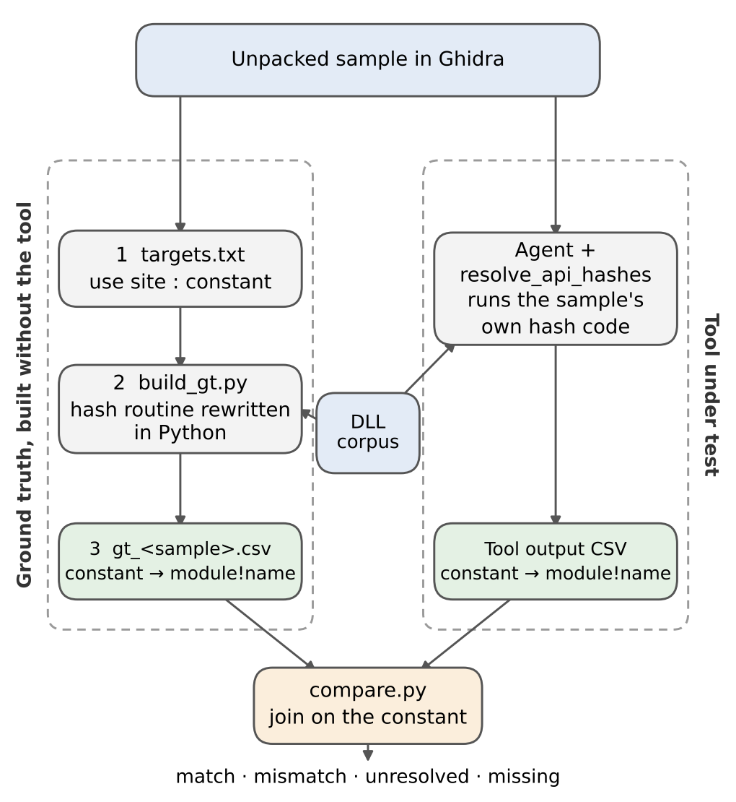

# Ground truth

Ground truth for the ten samples used to evaluate the API hash resolver. It was
built without the resolver, so the resolver can be scored against it.



## How it was built

For each sample:

1. Every place where the sample looks up an API by hash was found in Ghidra, and
   the constant used there was written to `targets.txt`, one `site:constant` per
   line.
2. The sample's hash routine was rewritten by hand in Python in `build_gt.py`.
   The script reads every export name from the DLLs in the corpus with `pefile`,
   hashes each one, and keeps the names whose hash equals a constant in
   `targets.txt`.
3. The result is written to `gt_<sample>.csv`.

The resolver runs the sample's own hash code under emulation. The script is a
separate rewrite of the same code in Python. Neither uses the other, so if one of
them is wrong, the two disagree.

## Layout

```
ground_truth/
  README.md
  groundtruth_flow.png
  compare/
    compare.py
  ground-truth-<sample>/
    build_gt.py
    targets.txt
    gt_<sample>.csv
```

`ground-truth-emotet/` also has `TUTORIAL.md`, a walkthrough in Ghidra of how
Emotet's constants are found and how a used hash is told apart from an unused
one.

| Sample      | Use sites | Distinct constants |
|-------------|----------:|-------------------:|
| BlackMatter |       210 |                208 |
| Netwalker   |       159 |                158 |
| LockBit 3.0 |       289 |                286 |
| Zloader     |       446 |                183 |
| Emotet      |       155 |                155 |
| REvil       |       152 |                143 |
| ToneShell   |        49 |                 49 |
| Conti       |        96 |                 96 |
| Latrodectus |       162 |                162 |
| AgentTesla  |        55 |                 34 |

## CSV columns

| Column      | Meaning |
|-------------|---------|
| `site`      | address of the use site |
| `constant`  | the hash constant used there |
| `role`      | `API` for a function name, `MODULE` for a DLL name |
| `module`    | the corpus DLL or DLLs the constant matches |
| `name`      | the matching name |
| `n_modules` | how many corpus DLLs export the name. More than one means the constant is ambiguous, and every candidate is listed. |

## Running it

```
pip install pefile
python build_gt.py [corpus_dir]
```

The default corpus path is set in `CORPUS` at the top of each script
(`C:\dll_corpus\x86` for 32-bit samples, `C:\dll_corpus\x64` for Latrodectus).
The DLLs are Microsoft binaries and are not included here. Copy them from a
Windows installation. The script prints a digest of the corpus it read, so two
runs can be checked against each other.

## Scoring the resolver

```
python compare/compare.py <gt_SAMPLE.csv> <tool_output> [out.csv]
```

`tool_output` is either the CSV the agent returns in section B of the prompt
(`address,hash,kind,module,resolved_name`) or the resolver's JSON result. The two
are joined on the constant. The script reports, per constant:

- `MATCH`: same name as the ground truth
- `MISMATCH`: a different name
- `UNRESOLVED`: the resolver was asked and found no name
- `MISSING`: the resolver was never asked about this constant
- `EXTRA`: the resolver answered a constant that is not in the ground truth

The resolver itself and the prompt are in the fork of `ghidra-mcp`, branch
`api-hash-resolver`.
